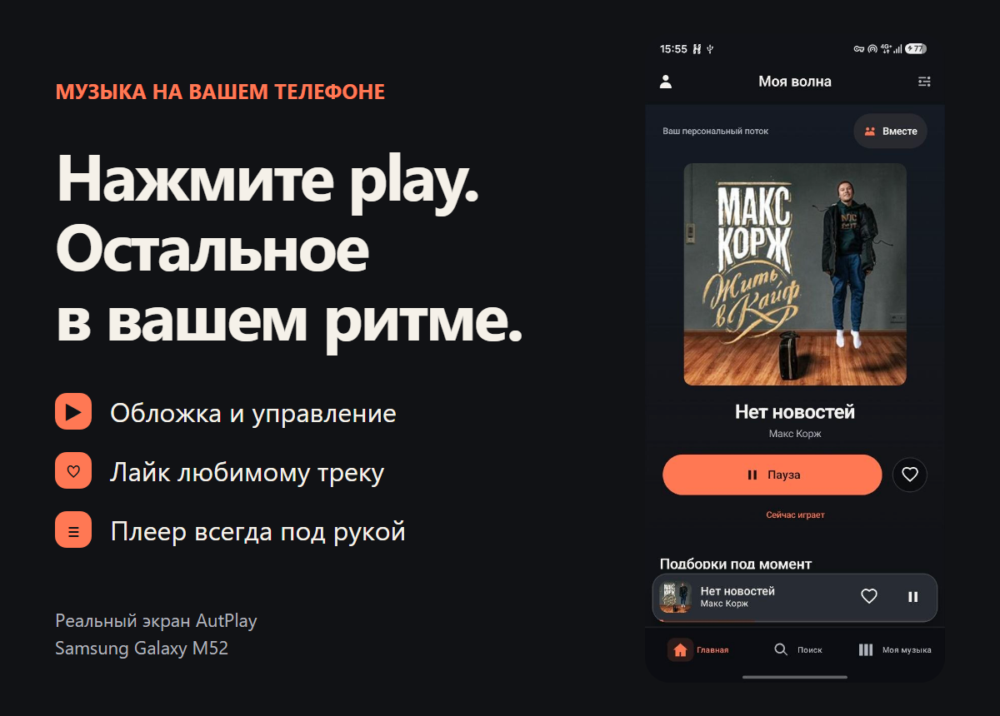
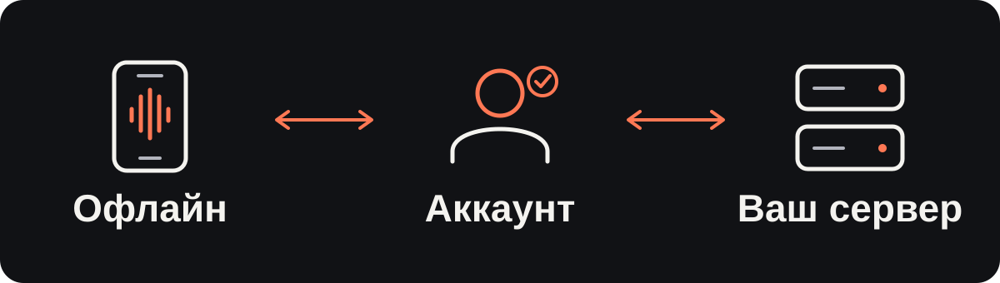

# AutPlay

<p align="center">
  
</p>

<p align="center">
  <strong><a href="https://github.com/Dakstar-cool/AutPlay/releases/download/v1.0.8/autplay-1.0.8-production.apk">Скачать для Android · 1.0.8</a></strong><br>
  Android 8.0+ · Русский и английский · Светлая и тёмная темы<br>
  <a href="#start">Начать слушать</a> · <a href="#account">Аккаунт и устройства</a> · <a href="#server">Личный сервер</a>
</p>

**AutPlay — плеер для вашей собственной музыкальной коллекции.** Добавьте треки на телефоне
и слушайте без сети. Подключите личный сервер, когда понадобятся общее хранилище,
синхронизация и доступ с другого устройства.

<p align="center">
  <a href="assets/readme/source/home-with-cover.png"></a>
</p>

## Ваша коллекция. В вашем ритме.

- **Библиотека, которую собираете вы.** Локальные треки, исполнители, альбомы и плейлисты;
  поиск, редактирование тегов и обложек.
- **Плеер под рукой.** Очередь, свайпы по обложке, лайки и управление из уведомления.
  Позиция и очередь сохраняются после перезапуска.
- **Музыка без сети.** Локальные файлы и заранее загруженные треки из вашего хранилища
  доступны, когда сервер отключён.
- **История ваших прослушиваний.** Локальная статистика на телефоне и общая статистика
  аккаунта после синхронизации устройств.
- **Оформление под себя.** Светлая или тёмная тема, четыре акцентных цвета, русский
  или английский интерфейс.

<a id="start"></a>

## От установки до первого трека

1. [Скачайте APK](https://github.com/Dakstar-cool/AutPlay/releases/download/v1.0.8/autplay-1.0.8-production.apk)
   и установите AutPlay на телефон.
2. Откройте **«Моя музыка» → «Добавить локальный трек»** и выберите аудиофайл.
3. Нажмите воспроизведение. Для локальной музыки подключение к серверу не требуется.

[Инструкция по установке и обновлению](docs/operations/GET_STARTED_1.0.8.md) ·
[Что нового в 1.0.8 и SHA-256 APK](https://github.com/Dakstar-cool/AutPlay/releases/tag/v1.0.8)

Обновление подписанной версии **1.0.6 → 1.0.8** проверено с сохранением данных приложения.
Если Android сообщает о другой подписи, сначала сохраните важные локальные данные:
старые development-сборки использовали другой ключ.

<a id="account"></a>

## Один аккаунт — несколько устройств

Создайте аккаунт с ID и паролем прямо на телефоне и сохраните файл восстановления.
Позже подключите его к совместимому серверу: другой телефон можно добавить через QR
или войти на нём по ID и паролю.

<p align="center">
  
</p>

История, предпочтения и плейлисты следуют за аккаунтом при смене совместимого сервера.
Для входа на новом телефоне нужна сохранённая серверная копия аккаунта либо файл
восстановления. Аудиофайлы передаются отдельно.

Выход и отключение аккаунта защищены проверкой ID и пароля. Если пароль потерян,
сохранённый файл или код восстановления поможет вернуть доступ.

[Подключение аккаунта, QR и восстановление](docs/operations/GET_STARTED_1.0.8.md#локальный-аккаунт)

<a id="server"></a>

## Личный сервер для вашей музыки

AutPlay работает самостоятельно на телефоне. Личный сервер расширяет его возможностями:

- **Vault** хранит вашу коллекцию и отдаёт музыку для потокового воспроизведения или загрузки.
- **Синхронизация** объединяет данные аккаунта и историю устройств.
- **Web Admin** помогает управлять хранилищем, устройствами и задачами сервера.

Сервер работает на CPU. Для самостоятельного развёртывания нужны PostgreSQL, хранилище,
секреты, HTTPS и резервное копирование. Исходники и инструкция доступны в репозитории;
во вложениях релиза 1.0.8 размещён только Android APK.

[Развёртывание сервера](docs/operations/DEPLOYMENT.md) ·
[Настройка аккаунтов](docs/operations/PORTABLE_ACCOUNTS.md) ·
[Резервное копирование](docs/operations/BACKUP_RESTORE.md)

<a id="developers"></a>

## Для разработчиков

Android-приложение написано на **Kotlin и Jetpack Compose**; для библиотеки и воспроизведения
используются Room, Media3 и WorkManager. Сервер — **Python и PostgreSQL** с файловым
хранилищем аудио. API и форматы обмена находятся в `contracts`.

[Окружение и сборка](docs/operations/FULL_PROJECT_SETUP.md) ·
[Архитектура](docs/design/AutPlay%20System%20Architecture%20v1.md) ·
[Проверки и выпуск](docs/operations/CI_RELEASE.md) ·
[Сообщить об ошибке](https://github.com/Dakstar-cool/AutPlay/issues)

<details>
<summary>Команды подготовки и проверки проекта</summary>

Нужны закреплённые версии Python с `uv`, JDK 17, Android SDK и Docker для временной тестовой
базы. Точные версии приведены в руководстве по окружению.

```powershell
powershell.exe -NoProfile -ExecutionPolicy Bypass -File .\scripts\bootstrap.ps1
powershell.exe -NoProfile -ExecutionPolicy Bypass -File .\scripts\check.ps1
```

```bash
bash scripts/bootstrap.sh
bash scripts/check.sh
```

APK 1.0.8 собран из commit `2b0a843` с параметрами
`-Pautplay.versionName=1.0.8 -Pautplay.versionCode=21 -Pautplay.productionRelease=true`.
Тег `v1.0.8` содержит тот же код приложения. Для замены установленного подписанного APK
нужен тот же ключ выпуска.

</details>
