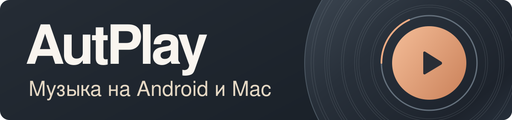
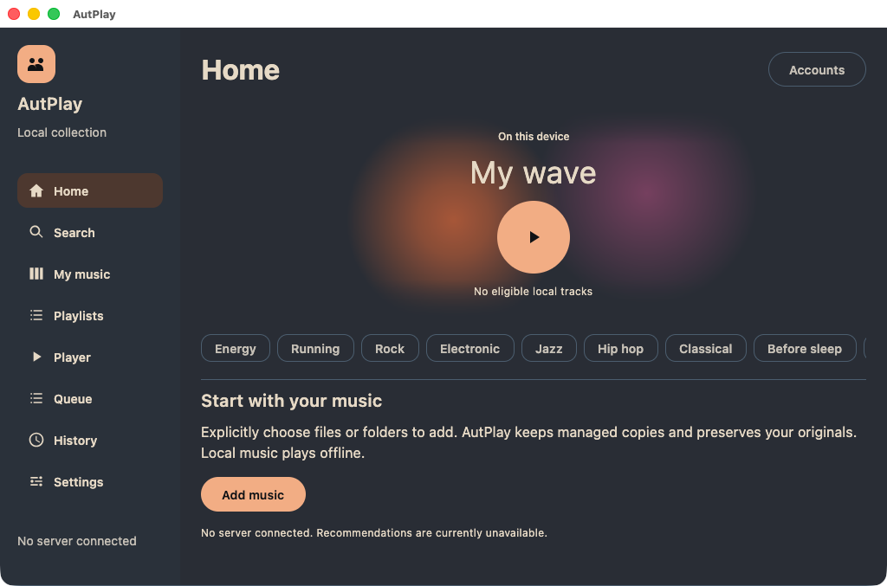

# 

  
  

**[Скачать для Android][apk]** · **[Скачать для Mac][dmg]** · [Что нового в 1.0.15][release]

Добавьте свои аудиофайлы и включите «Мою волну» — подборку из вашей медиатеки. Локальная музыка играет офлайн, без аккаунта и сервера.

## Первый трек

**Android 8.0 и новее.** Установите APK, откройте **«Моя музыка» → «Добавить локальный трек»** и выберите аудиофайл.

**Mac с Apple Silicon и macOS 13 или новее.** Перенесите AutPlay из DMG в **«Программы»**. В библиотеке нажмите **«Добавить музыку»** и выберите файлы или папку. Приложение сохранит оригиналы.

Сборка Mac Community подписана сертификатом проекта и распространяется без нотарификации Apple. [Первый запуск на Mac и обновление Android][guide]

## Плейлисты между Android и Mac

Передайте плейлист файлом `.autplaylist`. Перед импортом получатель увидит треки в том порядке, в каком вы их расставили. В файл входят названия и порядок треков. Для воспроизведения нужны сами записи. С личным сервером плейлистом можно поделиться и по ссылке.

## Личный сервер Sona

Sona добавляет каталог с поиском по исполнителям и альбомам. Треки из каталога можно сохранить на устройство для прослушивания без сети.

**Синхронизация.** Создайте аккаунт на Android, сохраните файл восстановления и войдите на Mac по ID и паролю. История, предпочтения и плейлисты появятся на обоих устройствах. Офлайн-копии музыки хранятся на каждом устройстве отдельно. [Подключить аккаунт][account-guide]

**Комнаты на Android.** Пригласите друзей слушать общую очередь. Ведущий управляет воспроизведением для группы до восьми устройств. Каждому участнику нужен доступ к треку. [Как работают комнаты][rooms-guide]

[Скачать Sona для Linux x86-64][sona] · [Развёртывание][deployment] · [Резервное копирование][backup]

## Разработка

Android-клиент написан на Kotlin с Jetpack Compose и Media3. Mac Community использует общие Kotlin-модули, Compose Desktop и AVFoundation. Сервер работает на Python и PostgreSQL.

Закреплённые версии инструментов и команды сборки собраны в [руководстве разработчика][setup].

[Архитектура][architecture] · [Контракты API][contracts] · [CI и выпуск][ci] · [Сообщить об ошибке][issues]

[apk]: https://github.com/Dakstar-cool/AutPlay/releases/download/v1.0.15/autplay-1.0.15-production.apk
[dmg]: https://github.com/Dakstar-cool/AutPlay/releases/download/v1.0.15/autplay-1.0.15-macos-arm64.dmg
[release]: https://github.com/Dakstar-cool/AutPlay/releases/tag/v1.0.15
[guide]: docs/operations/GET_STARTED_1.0.15.md
[account-guide]: docs/operations/GET_STARTED_1.0.15.md#account
[rooms-guide]: docs/development/WAVE_ROOMS.md
[sona]: https://github.com/Dakstar-cool/AutPlay/releases/download/v1.0.15/autplay-server-v1.0.15.docker.tar.gz
[deployment]: docs/operations/DEPLOYMENT.md
[backup]: docs/operations/BACKUP_RESTORE.md
[setup]: docs/operations/FULL_PROJECT_SETUP.md
[architecture]: docs/design/AutPlay%20System%20Architecture%20v1.md
[contracts]: contracts/openapi/v1/autplay-wave.openapi.json
[ci]: docs/operations/CI_RELEASE.md
[issues]: https://github.com/Dakstar-cool/AutPlay/issues
