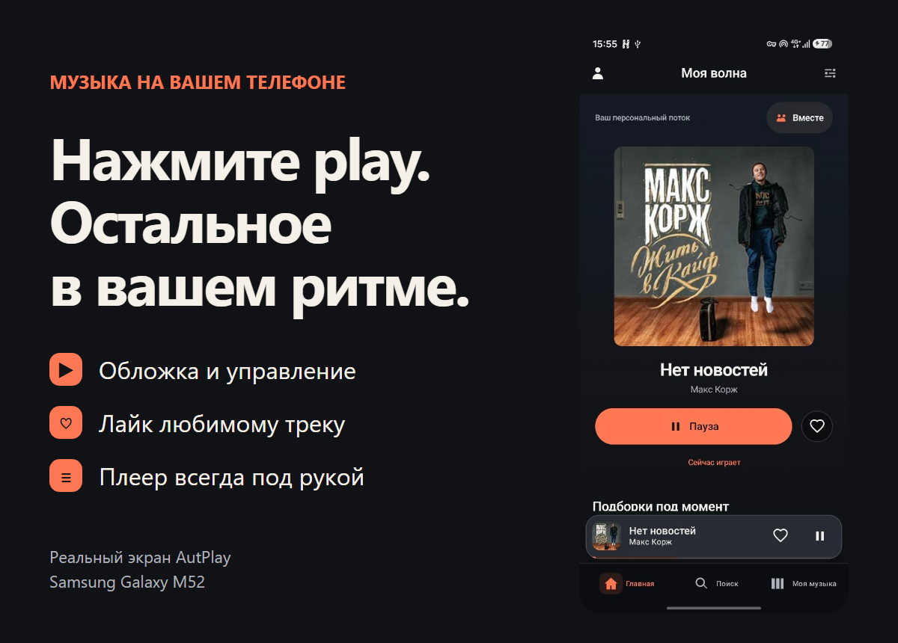
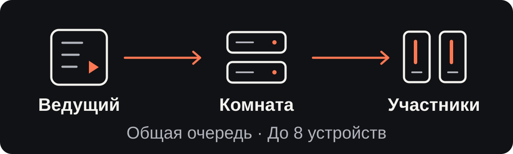

# AutPlay

<p align="center">
  
</p>

<p align="center">
  <strong><a href="https://github.com/Dakstar-cool/AutPlay/releases/download/v1.0.12/autplay-1.0.12-production.apk">Android · 1.0.12</a> · <a href="https://github.com/Dakstar-cool/AutPlay/releases/download/v1.0.12/autplay-1.0.12-macos-arm64.dmg">Mac · 1.0.12 Community</a></strong><br>
  Android 8.0+ · Mac с Apple Silicon, macOS 13+<br>
  Русский и английский<br>
  <a href="#start">Начать слушать</a> · <a href="#account">Аккаунт</a> · <a href="#rooms">Слушать вместе</a> · <a href="#developers">Разработчикам</a>
</p>

**AutPlay — плеер для вашей собственной музыкальной коллекции на Android и Mac.**
Добавьте локальные треки и слушайте без сети. Подключите личный сервер, когда понадобятся
общее хранилище, синхронизация и доступ с другого устройства.

<p align="center">
  <a href="assets/readme/source/home-with-cover.png"></a>
</p>

## Ваша коллекция. В вашем ритме.

- **Библиотека, которую собираете вы.** Локальные треки, исполнители, альбомы и плейлисты;
  поиск, редактирование метаданных и отображение обложек.
- **Плеер под рукой.** Очередь, свайпы по обложке, лайки и управление из уведомления.
  Позиция и очередь сохраняются после перезапуска.
- **Музыка без сети.** Локальные файлы и заранее загруженные треки из вашего хранилища
  доступны, когда сервер отключён.
- **История ваших прослушиваний.** Локальная статистика на телефоне и общая статистика
  аккаунта после синхронизации устройств.
- **Оформление под себя.** Акцентные цвета, русский или английский интерфейс.
- **Комната для совместного прослушивания.** С личным сервером — общая очередь,
  приглашения и согласованное воспроизведение на нескольких Android-устройствах.

<a id="start"></a>

## От установки до первого трека

1. Скачайте [APK для Android](https://github.com/Dakstar-cool/AutPlay/releases/download/v1.0.12/autplay-1.0.12-production.apk)
   или [DMG для macOS](https://github.com/Dakstar-cool/AutPlay/releases/download/v1.0.12/autplay-1.0.12-macos-arm64.dmg).
2. Установите APK на телефон или перенесите AutPlay из DMG в «Программы».
3. Откройте библиотеку, добавьте локальный аудиофайл и нажмите воспроизведение.
   Для локальной музыки подключение к серверу не требуется.

[Установка и обновление](docs/operations/GET_STARTED_1.0.12.md) ·
[Что нового и SHA-256 файлов](https://github.com/Dakstar-cool/AutPlay/releases/tag/v1.0.12)

Android-обновление устанавливается поверх версии с той же подписью. Если подпись отличается,
не удаляйте приложение с важными локальными данными. Для Mac Community особенности первого
запуска и доступные функции перечислены в [инструкции](docs/operations/GET_STARTED_1.0.12.md#mac).

<a id="account"></a>

## Один аккаунт — несколько устройств

Создайте аккаунт с ID и паролем на телефоне и сохраните файл восстановления.
Позже подключите его к совместимому серверу: другой телефон можно добавить через QR,
а на телефоне или Mac — войти по ID и паролю.

История, предпочтения и плейлисты следуют за аккаунтом при смене совместимого сервера.
Для обычного входа нужна сохранённая серверная копия аккаунта; файл восстановления
сохраните отдельно на случай потери доступа. Аудиофайлы передаются отдельно.

Выход и отключение аккаунта на Android защищены проверкой ID и пароля. Если пароль потерян,
используйте сохранённый файл или код восстановления.

[Подключение аккаунта и восстановление](docs/operations/GET_STARTED_1.0.12.md#account)

<a id="rooms"></a>

## Слушайте вместе в комнате

Комнаты доступны на Android с совместимым сервером; в Mac Community они пока не включены.
Создайте комнату в разделе **«Совместное прослушивание»**, пригласите участников
и соберите общую очередь. Ведущий выбирает музыку и управляет воспроизведением;
сервер согласует состояние на **восьми устройствах**, включая ведущего.

<p align="center">
  
</p>

- **Музыка из медиатеки.** Добавляйте треки в очередь; видны название, исполнитель
  и доступность на вашем устройстве.
- **Подготовка перед стартом.** Комната проверяет музыку и готовность устройств.
  Ведущий подготавливает следующий трек, затем запускает воспроизведение.
- **Приглашения.** Участники того же сервера входят по коду из десяти символов;
  для гостя без аккаунта предусмотрено отдельное приглашение.
- **Возвращение после обрыва связи.** Клиент восстанавливает очередь и позицию по данным
  сервера. При выходе возвращается личная очередь, если вы не заменили её другой.

**Каждому устройству нужен собственный доступ к треку** — локальный файл, готовая загрузка
или разрешённый поток из Vault. Приглашение само по себе не передаёт аудиофайлы.
Для комнат нужны согласованные версии Android и сервера; обновление клиента сервер не обновляет.

[Протокол и разработка комнат](docs/development/WAVE_ROOMS.md) ·
[Гостевой доступ](docs/adr/ADR-043-s1d-guest-room-capability-runtime.md)

<a id="server"></a>

## Личный сервер для вашей музыки

AutPlay работает самостоятельно на телефоне и Mac. Личный сервер добавляет:

- **Vault** — хранение музыки, потоковое воспроизведение и загрузки.
- **Синхронизацию** — данные аккаунта и историю устройств.
- **Комнаты Android** — общую очередь и согласование воспроизведения.
- **Web Admin** — управление хранилищем, устройствами и задачами сервера.

Сервер работает на CPU. Для самостоятельного развёртывания нужны PostgreSQL, хранилище,
секреты, HTTPS и резервное копирование. Релиз содержит Android APK и Mac DMG;
обновление сервера выполняется отдельно по инструкции.

[Развёртывание сервера](docs/operations/DEPLOYMENT.md) ·
[Настройка аккаунтов](docs/operations/PORTABLE_ACCOUNTS.md) ·
[Резервное копирование](docs/operations/BACKUP_RESTORE.md)

<a id="developers"></a>

## Для разработчиков

Android использует **Kotlin, Jetpack Compose, Room, Media3 и WorkManager**.
Mac — **Compose Multiplatform Desktop**, общие Kotlin-модули, SQLite и нативные адаптеры
AVFoundation и Keychain. Сервер — **Python и PostgreSQL** с файловым хранилищем аудио.
API и форматы обмена находятся в `contracts`.

[Окружение и сборка](docs/operations/FULL_PROJECT_SETUP.md) ·
[Архитектура](docs/design/AutPlay%20System%20Architecture%20v1.md) ·
[Mac: сборка и проверки](docs/operations/MACOS_CI.md) ·
[Mac Community: подпись и Keychain](docs/operations/MACOS_COMMUNITY.md) ·
[Проверки и выпуск](docs/operations/CI_RELEASE.md) ·
[Сообщить об ошибке](https://github.com/Dakstar-cool/AutPlay/issues)

<details>
<summary>Команды подготовки и проверки проекта</summary>

Запускайте из корня репозитория. Закреплённые версии: **Python 3.14.7**, **uv 0.12.3**,
**Microsoft OpenJDK 17.0.20+8-LTS**, **Android SDK 36.1 / Build Tools 36.1.0**.
Gradle запускается через wrapper; Docker нужен для временной PostgreSQL.

```powershell
powershell.exe -NoProfile -ExecutionPolicy Bypass -File .\scripts\bootstrap.ps1
powershell.exe -NoProfile -ExecutionPolicy Bypass -File .\scripts\check.ps1
```

```bash
bash scripts/bootstrap.sh
bash scripts/check.sh
# На Mac ARM64: нативные проверки и development-пакет.
bash scripts/check-desktop.sh --package-macos
```

Для серверного контура используйте `-ServerOnly` в PowerShell или `--server-only` в Bash.
Проверка поднимает собственную временную базу и очищает её после выполнения.
Для комнат проверяйте клиент, сервер и [OpenAPI](contracts/openapi/v1/autplay-wave.openapi.json)
согласованно: [сценарии проверки](docs/development/WAVE_ROOMS.md#checks).

Android 1.0.12 использует `versionCode 35`. Для замены установленного подписанного APK
нужен тот же ключ выпуска. Собственная Mac-подпись настраивается отдельно от Android.
Точные исходники, подписи и контрольные суммы опубликованных файлов указаны в релизе.

</details>
