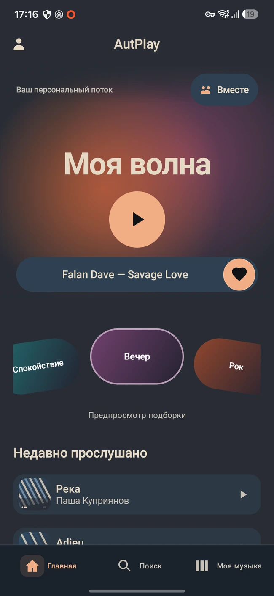

# AutPlay

Слушайте свою музыкальную коллекцию на **Android и Mac**. Добавьте файлы с устройства и включите «Мою волну». С личным сервером Sona можно искать музыку в каталоге, сохранять её для прослушивания без сети и делиться плейлистами.

**Скачать 1.0.14** · [Android APK][apk] · [Mac Community DMG][dmg] · [Все файлы выпуска][release]

<p align="center">
  <a href="assets/readme/android-wave.webp"></a>
  <a href="assets/readme/macos-wave.png"></a>
</p>

<a id="start"></a>

## Включить первый трек

- **Android 8.0 и новее.** Установите [APK][apk]. В «Моей музыке» добавьте локальный аудиофайл и нажмите ▶. Чтобы обновиться, установите APK поверх текущей версии с той же подписью.
- **Apple Silicon, macOS 13 и новее.** Откройте [DMG][dmg] и перенесите AutPlay в «Программы». Нажмите «Добавить музыку» и выберите файлы или папку. Оригиналы останутся на месте.

Для локальной музыки достаточно устройства. Сборка Mac Community подписана сертификатом проекта и распространяется без нотарификации Apple. [Первый запуск на Mac и обновление Android][guide]

## Что нового в 1.0.14

- **От исполнителя к альбому.** Откройте страницу исполнителя в каталоге, выберите издание и перейдите к списку треков. На Android просмотренный список остаётся доступен офлайн.
- **Плейлист с сохранённым порядком.** Передайте список файлом `.autplaylist` или постоянной ссылкой с сервера. Получатель видит состав перед импортом. Файл содержит порядок и сведения о треках, а аудио берётся из доступной коллекции.
- **«Моя волна» на Mac.** Запустите подборку по доступным локальным трекам. С подключённым аккаунтом Mac также поддерживает пакеты рекомендаций и воспроизведение из результатов поиска.
- **Загрузки из каталога.** Выберите трек или издание для сохранения. Клиент хранит состояние загрузки между запусками.

[Изменения выпуска и контрольные суммы][release]

<a id="account"></a>

## Один аккаунт на телефоне и Mac

На Android создайте аккаунт и сохраните файл восстановления. После подключения к совместимому серверу войдите на другом устройстве по ID и паролю. Второй телефон также можно добавить по QR-коду. История, предпочтения и плейлисты синхронизируются через аккаунт. Музыку для офлайн-прослушивания загрузите на каждое устройство. [Подключение аккаунта и восстановление](docs/operations/GET_STARTED_1.0.14.md#account)

<a id="rooms"></a>

## Слушать вместе на Android

В разделе «Совместное прослушивание» создайте комнату, добавьте треки и пригласите участников. Ведущий запускает общую очередь для группы до восьми устройств. Каждому нужен доступ к треку через локальный файл, загрузку или разрешённый поток из Vault. Комнаты доступны в клиенте Android с совместимым сервером. [Как работают комнаты](docs/development/WAVE_ROOMS.md) · [Гостевой доступ](docs/adr/ADR-043-s1d-guest-room-capability-runtime.md)

<a id="server"></a>

## Личный сервер Sona

[Скачать образ Sona для Linux x86-64][sona]. Vault хранит аудио и отдаёт его устройствам. Сервер также обслуживает каталог, общие плейлисты и комнаты. Для установки понадобятся PostgreSQL, хранилище и HTTPS. Перед обновлением сохраните резервную копию. [Развёртывание](docs/operations/DEPLOYMENT.md) · [Резервное копирование](docs/operations/BACKUP_RESTORE.md)

<a id="developers"></a>

## Для разработчиков

Android использует **Kotlin, Jetpack Compose, Room, Media3 и WorkManager**.
Mac — **Compose Multiplatform Desktop**, общие Kotlin-модули, SQLite и нативные адаптеры
AVFoundation и Keychain. Сервер — **Python и PostgreSQL** с файловым хранилищем аудио.
API и форматы обмена находятся в `contracts`.

[Окружение и сборка](docs/operations/FULL_PROJECT_SETUP.md) ·
[Архитектура](docs/design/AutPlay%20System%20Architecture%20v1.md) ·
[Mac: сборка и проверки](docs/operations/MACOS_CI.md) ·
[Mac Community: подпись и Keychain](docs/operations/MACOS_COMMUNITY.md) ·
[Проверки и выпуск](docs/operations/CI_RELEASE.md) ·
[Сообщить об ошибке](https://github.com/Dakstar-cool/AutPlay/issues)

<details>
<summary>Команды подготовки и проверки проекта</summary>

Запускайте из корня репозитория. Версии инструментов — **Python 3.14.7**, **uv 0.12.3**,
**Microsoft OpenJDK 17.0.20+8-LTS**, **Android SDK 36.1 / Build Tools 36.1.0**.
Gradle запускается через wrapper. Docker нужен для временной PostgreSQL.

```powershell
powershell.exe -NoProfile -ExecutionPolicy Bypass -File .\scripts\bootstrap.ps1
powershell.exe -NoProfile -ExecutionPolicy Bypass -File .\scripts\check.ps1
```

```bash
bash scripts/bootstrap.sh
bash scripts/check.sh
# На Mac ARM64: нативные проверки и development-пакет.
bash scripts/check-desktop.sh --package-macos
```

Для серверного контура используйте `-ServerOnly` в PowerShell или `--server-only` в Bash.
Проверка поднимает собственную временную базу и очищает её после выполнения.
Для комнат проверяйте клиент, сервер и [OpenAPI](contracts/openapi/v1/autplay-wave.openapi.json)
согласованно. См. [сценарии проверки](docs/development/WAVE_ROOMS.md#checks).

</details>

[apk]: https://github.com/Dakstar-cool/AutPlay/releases/download/v1.0.14/autplay-1.0.14-production.apk
[dmg]: https://github.com/Dakstar-cool/AutPlay/releases/download/v1.0.14/autplay-1.0.14-macos-arm64.dmg
[sona]: https://github.com/Dakstar-cool/AutPlay/releases/download/v1.0.14/autplay-server-v1.0.14.docker.tar.gz
[release]: https://github.com/Dakstar-cool/AutPlay/releases/tag/v1.0.14
[guide]: docs/operations/GET_STARTED_1.0.14.md
