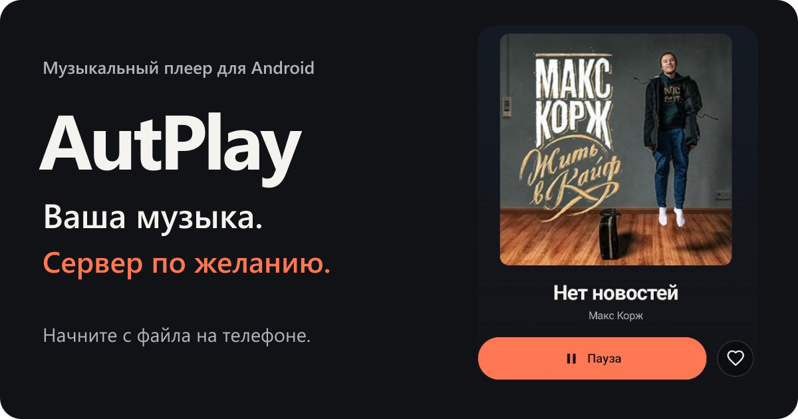

# AutPlay

<p align="center">
  <a href="assets/readme/source/home-with-cover.png"></a>
</p>

**Ваша коллекция, ваш аккаунт, ваш сервер.** AutPlay воспроизводит музыку на Android,
хранит библиотеку и историю на телефоне, а при подключении к личному серверу объединяет
данные аккаунта между устройствами. Начать слушать можно без сети.

**[Скачать AutPlay 1.0.8](https://github.com/Dakstar-cool/AutPlay/releases/download/v1.0.8/autplay-1.0.8-production.apk)** ·
[Что нового](docs/release/RELEASE_NOTES_1.0.8.md) ·
[Начать пользоваться](#start) ·
[Личный сервер](#server)

Android **8.0+** · Русский и английский · Светлая и тёмная темы

<a id="features"></a>

## Музыка всегда под рукой

- **Собственная библиотека.** Добавляйте аудиофайлы, находите треки, исполнителей и альбомы,
  собирайте плейлисты и редактируйте теги и обложки.
- **Удобное воспроизведение.** Управляйте очередью, переключайте треки свайпом по обложке,
  ставьте лайки из плеера и уведомления. Очередь и позиция сохраняются после перезапуска.
- **Офлайн-доступ.** Слушайте локальные файлы и музыку, заранее загруженную из личного
  хранилища. Отключение сервера не останавливает локальное воспроизведение.
- **Оформление под себя.** Выбирайте тему, один из четырёх акцентных цветов и язык интерфейса.

## Один аккаунт на разных устройствах

Создайте аккаунт с ID и паролем на телефоне, без регистрации на сервере. Позже подключите
его к своему серверу, добавьте другой телефон через QR или войдите по ID и паролю.
Идентичность аккаунта сохраняется при смене сервера.

- История прослушиваний, предпочтения и плейлисты переносятся между совместимыми серверами.
- Статистика учитывает данные аккаунта с подключённых устройств; без серверных данных
  доступна локальная история прослушиваний.
- Выход и отключение переносимого аккаунта требуют ID и пароль.
- Сохранённый файл или код восстановления помогает вернуть доступ при потере пароля.

<p align="center">
  
</p>

Перенос аккаунта синхронизирует данные о музыке. Сами аудиофайлы остаются на телефоне
или в вашем хранилище и передаются отдельно. Для входа на новом телефоне нужна ранее
сохранённая серверная копия аккаунта либо файл восстановления.

<a id="start"></a>

## Начать слушать

1. [Скачайте APK 1.0.8](https://github.com/Dakstar-cool/AutPlay/releases/download/v1.0.8/autplay-1.0.8-production.apk)
   и установите его на Android.
2. Откройте **«Моя музыка» → «Добавить локальный трек»** и выберите аудиофайл.
3. Запустите воспроизведение. Для этого не нужен сервер.
4. В профиле настройте **«Аккаунт»** и сохраните файл или код восстановления, если хотите
   пользоваться одним аккаунтом на разных устройствах.

[Установка, обновление и подключение аккаунта](docs/operations/GET_STARTED_1.0.8.md) ·
[Файлы выпуска и SHA-256](https://github.com/Dakstar-cool/AutPlay/releases/tag/v1.0.8)

Обновление **1.0.6 → 1.0.8** проверено с сохранением данных приложения. Старые development-APK
использовали другой ключ: при несовпадении подписи сохраните важные локальные данные,
прежде чем менять установку.

<a id="server"></a>

## Личный сервер

Сервер добавляет музыкальное хранилище **Vault**, синхронизацию аккаунта и устройств,
потоковое воспроизведение и Web Admin. Музыку из Vault можно загрузить на телефон для
прослушивания без сети. Сервер работает на CPU; GPU для этих возможностей не требуется.

В выпуске доступен совместимый образ сервера **linux/amd64** с поддержкой переносимых
аккаунтов. Самостоятельное развёртывание требует настройки PostgreSQL, хранилища, секретов,
HTTPS и резервного копирования. Архив образа предназначен для оператора сервера;
старый установщик 0.4.0 не является установщиком этого выпуска.

[Состав серверного образа](docs/release/RELEASE_NOTES_1.0.8.md#server) ·
[Настройка переносимых аккаунтов](docs/operations/PORTABLE_ACCOUNTS.md) ·
[Развёртывание](docs/operations/DEPLOYMENT.md) ·
[Резервное копирование](docs/operations/BACKUP_RESTORE.md)

Для обработки TXT-плейлистов доступен [отдельный загрузчик музыки](tools/local_music_acquisition/README.md).
Используйте его с источниками и файлами, которые вам разрешено скачивать.

<a id="developers"></a>

## Исходники и разработка

Android: Kotlin, Jetpack Compose, Room, Media3 и WorkManager. Сервер: Python, PostgreSQL
и файловое хранилище аудио. API и форматы обмена описаны в `contracts`.

[Окружение и сборка](docs/operations/FULL_PROJECT_SETUP.md) ·
[Архитектура](docs/design/AutPlay%20System%20Architecture%20v1.md) ·
[Проверки и выпуск](docs/operations/CI_RELEASE.md) ·
[Сообщить об ошибке](https://github.com/Dakstar-cool/AutPlay/issues)

<details>
<summary>Подготовка окружения и проверка проекта</summary>

Нужны закреплённые версии Python с `uv`, JDK 17, Android SDK и Docker для временной тестовой
базы. Точные версии и дополнительные зависимости приведены в руководстве по окружению.

```powershell
powershell.exe -NoProfile -ExecutionPolicy Bypass -File .\scripts\bootstrap.ps1
powershell.exe -NoProfile -ExecutionPolicy Bypass -File .\scripts\check.ps1
```

```bash
bash scripts/bootstrap.sh
bash scripts/check.sh
```

Подписанный APK 1.0.8 построен из commit `2b0a843` с параметрами
`-Pautplay.versionName=1.0.8 -Pautplay.versionCode=21 -Pautplay.productionRelease=true`.
Тег `v1.0.8` содержит тот же код приложения и обновлённую документацию.
Самостоятельная сборка без ключа выпуска не заменяет подписанный APK.

</details>
