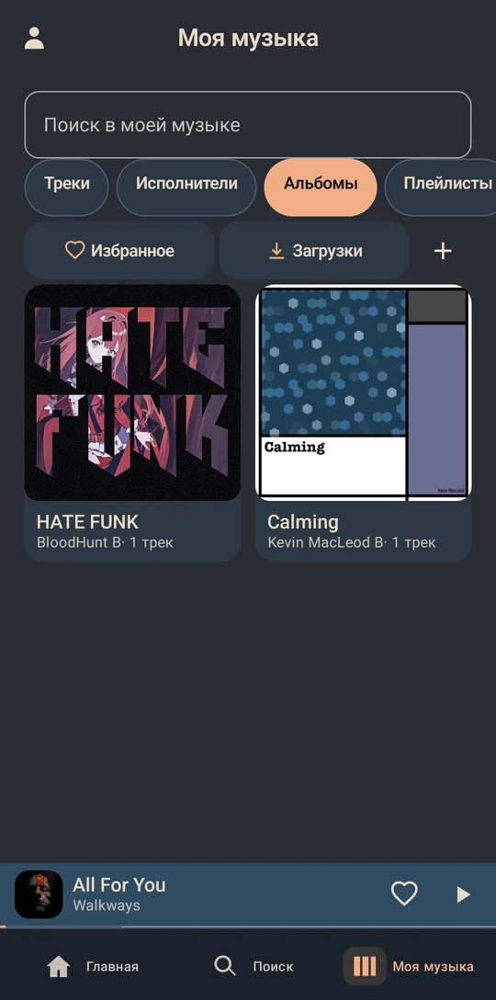

#  AutPlay

Музыкальный плеер для Android и Mac. Добавьте свои записи, соберите плейлист или включите «Мою волну». Локальную библиотеку можно слушать офлайн. Личный сервер Sona добавляет общий каталог, синхронизацию и совместное прослушивание.

**[Скачать AutPlay][downloads]** · [Установка Android и Mac][guide] · [Что нового в 1.0.16][notes]

## Что умеет AutPlay

<p align="center">
  <a href="assets/readme/android-home.webp"></a>
  <a href="assets/readme/android-player.webp"></a>
  <a href="assets/readme/android-albums.webp"></a>
</p>

**«Моя волна».** Выберите настроение на главной или запустите персональную подборку. На Android очередь пополняется по мере прослушивания. Сердечком можно отметить удачную находку прямо в плеере или в шторке Android.

**Своя библиотека.** Ищите запись по треку, исполнителю или альбому. Откройте карточку артиста, чтобы перейти к дискографии. В блоке «Новинки для вас» появляются релизы знакомых исполнителей. Для треков из каталога доступно скачивание на устройство.

**Плеер.** Откройте обложку, чтобы развернуть плеер, посмотреть очередь, включить повтор или поставить таймер сна. Плеер учитывает оформление записи, а при отсутствии обложки показывает иллюстрацию.

<a id="start"></a>

### Локальная музыка и плейлисты на двух платформах

На Android откройте **Моя музыка → Добавить локальный трек**. На Mac выберите в библиотеке **Добавить музыку** и укажите файлы или папку. AutPlay создаст управляемые копии и сохранит оригиналы.

<a href="assets/readme/mac-library.webp"></a>

Плейлист можно передать файлом `.autplaylist`. При импорте видны состав и порядок записей. Для прослушивания получателю нужен доступ к самим трекам. С личным сервером плейлистом можно поделиться по ссылке.

Для установки нужны Android 8.0+ или Mac с Apple Silicon и macOS 13+. Mac Community подписан сертификатом проекта. Порядок первого запуска и проверки загруженных файлов приведён в [руководстве по установке][guide].

<a id="server"></a>

### Личный сервер Sona

- <a id="account"></a>**Один аккаунт на нескольких устройствах.** Создайте аккаунт на Android и сохраните файл восстановления. После входа на Mac можно синхронизировать историю, предпочтения и плейлисты. Скачанные аудиофайлы хранятся отдельно на каждом устройстве. [Подключение аккаунта][accounts]
- <a id="rooms"></a>**Комнаты на Android.** Ведущий запускает общую очередь для группы до восьми устройств. Участникам нужен доступ к выбранной музыке. [Устройство комнат][rooms]
- **Каталог и архив Vault.** Сервер уточняет названия, версии записей, авторство и обложки. Music Preservation Watcher проверяет отслеживаемые релизы по расписанию. Найденный материал можно передать в Vault при подтверждённых правах и совпадении записи. [Источники и разрешения][vault]

## Что дальше

- **Комнаты на Mac.** Для подключения настольного клиента предстоит проверить синхронизацию часов и воспроизведения с Android. [План функций Mac Community][mac-plan]
- **Персональные рекомендации Sona.** Следующий этап обучения требует накопить реальные показы и завершённые прослушивания, а также получить векторные представления аудио. [Состояние работы с рекомендациями][sona-model]

<a id="developers"></a>

## Разработчикам

| Часть проекта | Где искать |
| --- | --- |
| Android-приложение, экраны Compose, Media3 и локальное хранилище Room | [apps/android](apps/android) |
| Mac Community, Compose Desktop и воспроизведение через AVFoundation | [apps/desktop](apps/desktop) · [Сборка и ограничения][mac] |
| Общие Kotlin-модули клиентов | [shared](shared) |
| API Sona, фоновые задания, модели данных и миграции PostgreSQL | [server](server) · [Контракт HTTP API][api] |
| Вычисления и обучение рекомендаций | [gpu](gpu) · [gpu/training](gpu/training) |
| Получение музыки, архив и нормализация метаданных | [tools/local_music_acquisition](tools/local_music_acquisition) · [Обработчик метаданных][metadata] |
| Развёртывание, обновление и восстановление сервера | [deploy](deploy) · [Руководство оператора][deployment] · [Резервные копии][backup] |

### Подготовка окружения

Понадобятся Git, uv, JDK 17 и Android SDK для Android. Полная серверная проверка использует Docker, PostgreSQL с pgvector и FFmpeg. Версии и пути для `JAVA_HOME` и `ANDROID_HOME` перечислены в [руководстве по настройке][setup].

```powershell
# Windows, из корня репозитория
.\scripts\bootstrap.ps1
.\gradlew.bat --dependency-verification=strict -Pautplay.qaSideBySide=true :apps:android:assembleDebug
.\gradlew.bat --dependency-verification=strict :apps:android:testDebugUnitTest
```

```bash
# Linux или macOS, из корня репозитория
bash scripts/bootstrap.sh
# Серверные тесты
(cd server && uv run --frozen pytest -q)
# Нативные проверки настольного клиента на Mac
bash scripts/check-desktop.sh
```

QA-сборка Android использует идентификатор `app.autplay.qa` и устанавливается рядом с обычным приложением. Для полной проверки используйте `scripts/check.ps1` или `scripts/check.sh`. Порядок запуска временной базы, интеграционных и инструментальных тестов описан в руководстве разработчика. [Настройка и проверки][setup]

### Контракты и выпуск

Изменения API сверяйте с OpenAPI, изменения хранилищ — с миграциями. Для проверки совместимости аккаунтов и синхронизации используйте документацию протоколов. Выпуск включает подписанный APK, DMG Mac Community и отдельно обозначенный архив серверного Docker-образа для Linux x86-64. GitHub формирует архивы исходников из тега.

[Архитектура][architecture] · [Переносимые аккаунты][portable] · [Переходы между треками][transitions] · [CI и порядок выпуска][ci] · [Сообщить об ошибке][issues]

[downloads]: https://github.com/Dakstar-cool/AutPlay/releases/latest
[guide]: docs/operations/GET_STARTED_1.0.16.md
[notes]: docs/release/RELEASE_NOTES_1.0.16.md
[accounts]: docs/operations/GET_STARTED_1.0.16.md#account
[rooms]: docs/development/WAVE_ROOMS.md
[vault]: tools/ACQUISITION_VAULT_BRIDGE.md#music-preservation-watcher
[mac-plan]: docs/operations/MACOS_FEATURE_MATRIX.md
[sona-model]: docs/operations/SONA_OWNER_RECOMMENDATIONS.md
[mac]: docs/operations/MACOS_COMMUNITY.md
[api]: contracts/openapi/v1/autplay-wave.openapi.json
[metadata]: docs/operations/METADATA_WORKER.md
[deployment]: docs/operations/DEPLOYMENT.md
[backup]: docs/operations/BACKUP_RESTORE.md
[setup]: docs/operations/FULL_PROJECT_SETUP.md
[architecture]: docs/design/AutPlay%20System%20Architecture%20v1.md
[portable]: docs/operations/PORTABLE_ACCOUNTS.md
[transitions]: docs/development/PLAYBACK_TRANSITIONS.md
[ci]: docs/operations/CI_RELEASE.md
[issues]: https://github.com/Dakstar-cool/AutPlay/issues
