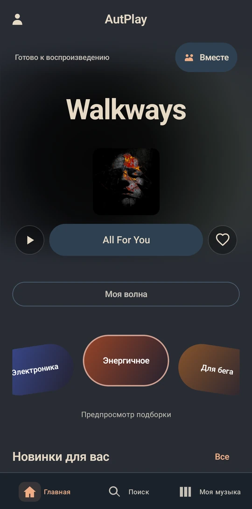
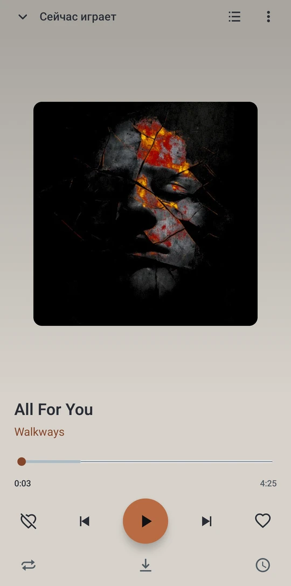
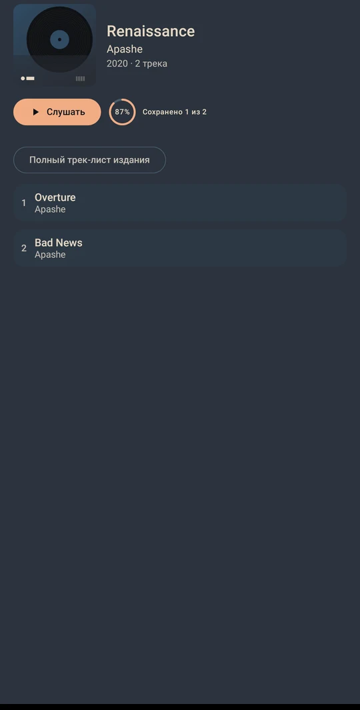
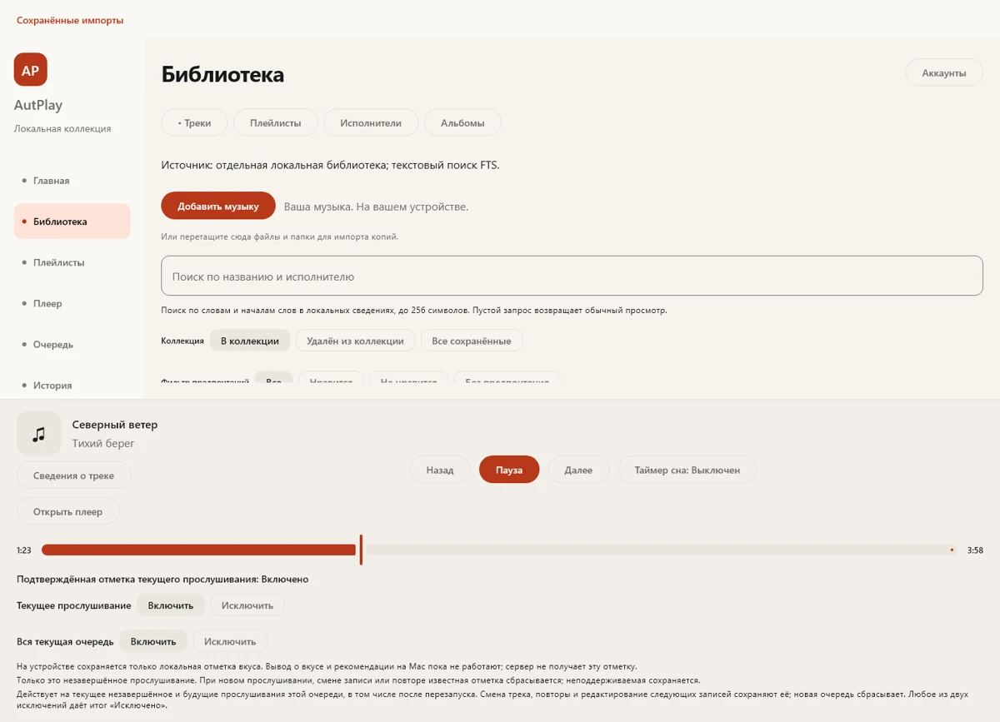

<p align="center"></p>
<h1 align="center">AutPlay</h1>

<p align="center"><strong>Музыкальная библиотека и плеер для Android и Mac</strong></p>

Добавьте свои аудиофайлы и слушайте их офлайн. Включите **«Мою волну»**, чтобы заново открыть музыку из коллекции. С личным сервером **Sona** можно переносить плейлисты, искать издания альбомов и слушать вместе на Android.

**[Скачать для Android][apk]** · **[Скачать для Mac][dmg]** · [Установка][guide] · [Что нового в 1.0.17][notes]

## Интерфейс

<p align="center">
  <a href="assets/readme/android-home.webp"></a>
  <a href="assets/readme/android-player.webp"></a>
  <a href="assets/readme/android-album-download.webp"></a>
</p>

**Android.** Главная, плеер и загрузка альбома. Нажмите на снимок, чтобы рассмотреть экран.

<p align="center"><a href="assets/readme/mac-library.webp"></a></p>

**Mac Community.** Библиотека и управление воспроизведением в одном окне.

## Возможности

<a id="start"></a>

### Библиотека и плеер

- **Локальная музыка.** На Android откройте **Моя музыка → Добавить локальный трек**. На Mac выберите **Добавить музыку** или перетащите файлы и папки в библиотеку. Mac сохраняет оригиналы и создаёт копии для плеера.
- **Очередь и управление.** Доступны очередь, повтор, перемешивание и таймер сна. На Android можно перемотать трек прямо с главной, оценить его в уведомлении и вернуться к сохранённой позиции после перезапуска.
- **Моя волна.** Выбирайте настроение, отмечайте любимые записи и пропускайте неподходящие. Android пополняет очередь по мере прослушивания. На Mac доступна локальная волна, а подключённый аккаунт может получать подборки Sona.
- **Личная медиатека.** Ищите треки, альбомы и исполнителей, собирайте плейлисты, просматривайте историю. На Android доступны редактирование метаданных и обложек, статистика прослушиваний, настройки звука, светлая и тёмная темы.
- **Перенос плейлистов.** Файл `.autplaylist` сохраняет порядок записей между Android и Mac. Перед добавлением можно проверить состав. Для воспроизведения получателю нужен доступ к самим трекам.

<a id="server"></a>

### Каталог, импорт и офлайн-загрузки с Sona

- **Исполнители и релизы.** Из карточки артиста можно перейти к дискографии и совместным записям. «Новинки для вас» показывает релизы знакомых исполнителей.
- **Трек-листы альбомов.** Откройте издание, чтобы посмотреть диски, порядок треков и доступность записей в вашем Vault. При нескольких совпадениях можно выбрать издание MusicBrainz или Discogs.
- **Импорт по ссылке.** Поддерживаются Яндекс Музыка, Spotify и SoundCloud. Перед сохранением видны состав коллекции и доступные записи. Для каждого источника действуют свои условия доступа. [Возможности источников][import]
- **Загрузки на устройство.** Сохраните доступную музыку из каталога для прослушивания без сети. На Android виден ход загрузки трека или коллекции. Если скачалась только часть плейлиста, можно повторить загрузку.
- **Хранилище Vault.** Sona выдаёт доступные аккаунту аудиофайлы и потоки. Владелец сервера может управлять заданиями и обновлять отображаемые названия через Web Admin. Music Preservation Watcher проверяет отслеживаемые релизы по расписанию. [Хранилище и источники][vault]

<a id="account"></a>

### Аккаунт и совместное прослушивание

- **Один аккаунт на разных устройствах.** Синхронизируйте историю, предпочтения и плейлисты. При первом подключении можно перенести любимые треки и выбрать исполнителей для стартовой волны. На Android доступны привязка телефона по QR и восстановление доступа с помощью сохранённого файла или кода. [Подключение и восстановление][accounts]
- **Друзья и приватность на Android.** Находите друзей по публичному ID, управляйте запросами, приглашениями и видимостью статистики.
- <a id="rooms"></a>**Комнаты на Android.** Ведущий собирает общую очередь и управляет воспроизведением на группе до восьми устройств. Можно пригласить гостя или вернуться в комнату после обрыва связи. Каждому участнику нужен доступ к выбранной записи. [Как работают комнаты][rooms]

## В планах

| Направление | Что предстоит сделать |
| --- | --- |
| Совместное прослушивание на Mac | Подключить Mac к комнатам и проверить на устройствах синхронный старт, паузу и восстановление связи с Android. [План Mac Community][mac-plan] |
| Рекомендации Sona | Подготовить следующий этап обучения на реальных показах, завершённых прослушиваниях и признаках аудиозаписей. [Состояние системы рекомендаций][sona-model] |

<a id="developers"></a>

## Разработчикам

| Компонент | Технологии и точки входа |
| --- | --- |
| Android | Kotlin, Jetpack Compose, Media3, Room и WorkManager. [Приложение](apps/android) · [Воспроизведение](docs/development/PLAYBACK_TRANSITIONS.md) |
| Mac Community | Kotlin, Compose Desktop и AVFoundation. [Клиент](apps/desktop) · [Общие модули](shared) · [Сборка и подпись](docs/operations/MACOS_COMMUNITY.md) |
| Sona | Python, PostgreSQL и файловое хранилище Vault. [Сервер](server) · [Контракты API](contracts/openapi/v1) · [Фоновые обработчики](docs/operations/METADATA_WORKER.md) |
| Обработка музыки | [Поиск и получение записей](tools/local_music_acquisition) · [Вычисления и обучение](gpu) |

Из корня репозитория на Windows можно собрать QA-версию Android и запустить модульные тесты. Она устанавливается рядом с обычным приложением.

```powershell
.\scripts\bootstrap.ps1
.\gradlew.bat --max-workers=1 --dependency-verification=strict -Pautplay.qaSideBySide=true :apps:android:assembleDebug
.\gradlew.bat --max-workers=1 --dependency-verification=strict :apps:android:testDebugUnitTest
```

Для серверных проверок на Linux выполните `bash scripts/bootstrap.sh --server-only`, затем `bash scripts/check.sh --server-only`. Для нативных проверок на Mac используйте `bash scripts/check-desktop.sh`.

[Настройка окружения](docs/operations/FULL_PROJECT_SETUP.md) · [Архитектура](docs/design/AutPlay%20System%20Architecture%20v1.md) · [Развёртывание Sona](docs/operations/DEPLOYMENT.md) · [Резервные копии](docs/operations/BACKUP_RESTORE.md) · [CI и выпуск](docs/operations/CI_RELEASE.md) · [Сообщить об ошибке](https://github.com/Dakstar-cool/AutPlay/issues)

[apk]: https://github.com/Dakstar-cool/AutPlay/releases/download/v1.0.17/autplay-1.0.17-production.apk
[dmg]: https://github.com/Dakstar-cool/AutPlay/releases/download/v1.0.17/autplay-1.0.17-macos-arm64.dmg
[guide]: docs/operations/GET_STARTED_1.0.17.md
[notes]: docs/release/RELEASE_NOTES_1.0.17.md
[import]: docs/operations/EXTERNAL_MUSIC_IMPORT.md
[accounts]: docs/operations/GET_STARTED_1.0.17.md#account
[rooms]: docs/development/WAVE_ROOMS.md
[vault]: tools/ACQUISITION_VAULT_BRIDGE.md#music-preservation-watcher
[mac-plan]: docs/operations/MACOS_FEATURE_MATRIX.md
[sona-model]: docs/operations/SONA_OWNER_RECOMMENDATIONS.md
