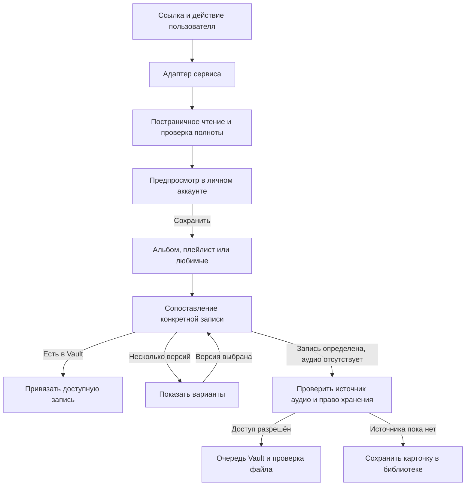

# Импорт музыки в AutPlay по ссылке

Проект архитектуры для обсуждения, 26 ноября 2026 года. Направление переноса — из Яндекс Музыки, Spotify и SoundCloud в личную библиотеку AutPlay. Android и настольный клиент используют один серверный механизм. Первый выпуск выполняет перенос по запросу и допускает повторную проверку той же ссылки.

## Что получит пользователь

| Действие | Результат |
|---|---|
| Открыть ссылку на альбом | AutPlay находит конкретное издание в дискографии артиста или создаёт его карточку с порядком дисков и треков. Уже доступные пользователю записи можно слушать сразу. Недостающие подтверждённые записи поступают в очередь Vault при наличии разрешённого источника аудио. |
| Добавить плейлист по ссылке | В «Моих плейлистах» появляется личная копия с названием, порядком и повторами. Лайки и «уже слушал» зависят от личных действий пользователя. Такой импорт сам по себе не запускает массовую загрузку аудио или пополнение каталога другими песнями тех же артистов. |
| Перенести любимые | Отдельное действие принимает ссылку на лайки, публичную копию коллекции или подключение аккаунта. Пользователь видит число треков и подтверждает их добавление в «Любимое». AutPlay записывает исходный лайк и признак «знаком по импорту», затем подбирает аудио для Vault. Реальные воспроизведения, даты и минуты появляются при прослушивании. |

Альбом и плейлист делят поле «Вставить ссылку» и обработчик системного действия «Поделиться». Экран «Перенести любимые» явно задаёт значение ссылки. Один и тот же публичный плейлист можно перенести как подборку или выбрать его на этом экране как собственное избранное. У SoundCloud лайк целого сета предлагается перенести как плейлист, песни внутри не получают персональные лайки автоматически.

## Путь одного импорта

Сервер получает владельца библиотеки из сессии AutPlay. Адаптер определяет тип ссылки и способ доступа, читает метаданные и сообщает, дошёл ли до последней страницы. В короткой ссылке раскрывается только разрешённый переход на поддерживаемую площадку. Ключи приложений и пользовательские OAuth-токены находятся на сервере. Исходные параметры для отслеживания, токены и временные ссылки на аудио не входят в постоянные идентификаторы.

Клиент начинает импорт с ключом повтора, читает его состояние и подтверждает конкретную редакцию предпросмотра. Если нужна авторизация, пользователь возвращается к тому же заданию после входа. Подтверждение формирует личную коллекцию и задания дальнейшей обработки одной транзакцией через очередь или outbox. Экран можно закрыть и позднее открыть с другого устройства. Если файл временно недоступен, любимый трек уже виден в библиотеке.

## Особенности трёх источников

| Источник | Контракт адаптера |
|---|---|
| **Яндекс Музыка** | Обрабатывает альбом, публичный плейлист и «Мне нравится». Для лайков сверяет подробный плейлист со списком отметок по ID. Предлагает сверку после выбора пользователем своей публичной коллекции. Сохраняет исходные ID трека и альбома, дату лайка, доступные сведения о версии и связи `realId` и `duplicates`. Запись с `no-rights` может по-прежнему иметь имя, артиста и исходный ID. Пропуск в нумерации остаётся расхождением до появления сведений о записи. Клиент API неофициальный, поэтому форматы проверяются независимо для каждого вида ссылки. [Плейлисты](https://ym.marshal.dev/yandex_music._client.playlists/) · [Лайки](https://ym.marshal.dev/yandex_music._client.likes/) · [Условия сервиса](https://yandex.ru/legal/music_termsofuse/ru) |
| **Spotify** | Альбом по ID используется для поиска издания в собственном каталоге. Для переноса собственных или совместных плейлистов и сохранённых треков используется официальный API с подходящими правами, в том числе `user-library-read` для избранного. Ссылка `/collection/tracks` открывает подключение аккаунта. В двух гостевых тестах обычная веб-страница раскрыла 1 000 позиций после прокрутки, встроенный плеер — 100. Публичный прототип и доступ, разрешённый для распространяемого приложения, оцениваются отдельно. В Development Mode доступ к составу плейлистов и числу пользователей ограничен. Правила переноса персональных данных и метаданных пользовательских плейлистов определяют доступные операции. [Доступ к плейлистам](https://developer.spotify.com/documentation/web-api/tutorials/february-2026-migration-guide) · [Сохранённые треки](https://developer.spotify.com/documentation/web-api/reference/get-users-saved-tracks) · [Политика Spotify](https://developer.spotify.com/policy) |
| **SoundCloud** | Определяет тип сета по метаданным, у ссылки профиля читает публично доступные лайки до конца выдачи. В отчёте отдельно показывает треки, сеты, заявленные числа и фактически прочитанные позиции. Публичный API предусматривает авторизацию приложения для публичных ресурсов. Для промышленной интеграции постоянное хранение данных источника зависит от разрешённого режима — стандартные условия API ограничивают его сеансовым кэшем. До появления подходящего основания содержимое SoundCloud служит временным предпросмотром, а постоянная библиотека опирается на независимо полученные записи и действие пользователя либо на разрешённый пользовательский экспорт. Поток SoundCloud не служит источником файла Vault или акустического отпечатка. [Руководство API](https://developers.soundcloud.com/docs/api/guide) · [Условия API](https://developers.soundcloud.com/docs/api/terms-of-use) |

Каждый адаптер объявляет поддержанные действия, способы авторизации, лимиты, разрешённые способы использования и сроки хранения. Эти условия применяются к сохранению происхождения данных, поиску аудио и рекомендациям. Например, для данных Spotify правила ограничивают построение профилей и передачу контента в модели. Экран «Любимое» и использование сигнала стартовой Волной получают отдельные решения о доступе. Если условия источника допускают использование лайка для рекомендаций, Волна может учесть его ещё до окончания загрузок. Собственная история формируется по взаимодействиям с музыкой в AutPlay.

## Данные, полнота и повторный импорт

Опора в коде — существующие `importing.import_job` и `importing.import_entry`, личные ссылки на треки, каталог записей и журнал решений о совпадении. Предлагается расширить их контракт источником, типом коллекции, режимом импорта, редакцией, курсором и счётчиками. Снимок хранит только разрешённые для данного источника сведения. [ADR об импорте и идентичности](../../adr/ADR-023-p10-import-identity-runtime-and-review-boundary.md) · [Контракт адаптеров](../../../server/src/autplay/ports/source_adapters.py)

- **Коллекция** привязана к владельцу, сервису, ID коллекции и выбранному действию. Повтор ссылки открывает уже начатую операцию или обновляет её результат. Пользователь может отдельно создать новую копию.
- **Вхождение** хранит позицию, диск и номер дорожки, где применимо, внешний ID и дату лайка, если её отдаёт источник. Одна запись может встречаться в плейлисте несколько раз. Для сравнения редакций повторяющиеся вхождения учитываются отдельно.
- **Запись и файл** имеют разные идентификаторы. Внешний ID, ID издания, ISRC при наличии, признаки версии, длительность и происхождение связываются с решением о записи. Проверенный файл имеет собственный хеш и права доступа. Несколько внешних ID могут указывать на одну запись, а одна запись — встречаться в разных изданиях.
- **Полнота** видна по четырём показателям. Сколько позиций заявил источник, сколько удалось прочитать, для скольких определена запись и у скольких есть доступное аудио. Для лайков SoundCloud счётчики ведутся отдельно по типу. Если курсор исчерпан, но счётчики расходятся, итог сообщает «получено доступных» с обоими числами. Оборванная загрузка получает статус частичной и доступна для продолжения.
- **Повтор и сбои.** Страница данных и следующий курсор фиксируются вместе. При ограничении частоты запросов задание учитывает `Retry-After`. При смене редакции проверка начинается с согласованного снимка. Повтор подтверждения или одновременная отправка с телефона и компьютера не создают вторую коллекцию, лайк или загрузку одной и той же подтверждённой версии.
- **Изменения у источника.** Полные сравнимые снимки позволяют отметить внешнее исчезновение. Причины «снят лайк», «закончились права» и «запись больше не опубликована» различимы только при соответствующих данных. Из личного архива трек убирает сам пользователь. Его ручной выбор версии, снятие лайка и правки плейлиста имеют приоритет при повторном импорте. После отзыва доступа адаптер прекращает новые чтения и очищает исходные данные по правилам сервиса.

## Как подтвердить версию и заполнить Vault

Поиск начинается среди записей, которые владелец уже может воспроизводить из личного Vault или доступного ему общего каталога. Для новой связи пригодны ранее подтверждённый внешний ID и привязка конкретного трека к конкретному изданию с совместимыми признаками. Связь старого и нового альбома `duplicates` сужает поиск, затем сверяются сами дорожки. Поиск по артисту и названию собирает кандидатов. Вместе с решением сохраняются доказательства и конкурирующие варианты. Пометки live, remix, remaster, explicit/clean, различия в длительности и треклисте влияют на решение. Неизвестная длительность или метка версии учитываются как отсутствующее доказательство.

Если источник позволяет акустическое сравнение, отпечаток доступного фрагмента может подтвердить уже имеющийся файл на проверенном интервале. Хеш SHA-256 подтверждает тождество байтов. Эти проверки отвечают на разные вопросы. Действующий ADR допускает теневую оценку вероятностных совпадений. Спорные совпадения проходят через существующий разбор. Выбор пользователя сохраняется с доказательствами. [Правила идентичности](../../adr/ADR-023-p10-import-identity-runtime-and-review-boundary.md) · [Текущий подбор кандидатов](../../../server/src/autplay/application/playlist_vault.py)

За получение аудио отвечает отдельный работник. Он проверяет разрешение на получение и хранение из выбранного источника, фиксирует запись и версию, проверяет полученный файл и публикует доступность после commit Vault. При повторной попытке файл переиспользуется в рамках действующих прав. Отмена и отзыв прав проверяются перед публикацией. Для режима сохранения исчезающего оригинала в репозитории уже предусмотрены отдельный допуск, проверка версии и контрольная сумма. Личная коллекция не публикует автоматически общедоступный файл. [Публикация и проверка Vault](../../../tools/ACQUISITION_VAULT_BRIDGE.md)

## Внедрение и проверка

1. **Вертикальный прототип с Яндекс Музыкой.** Принять ссылку, показать предпросмотр, применить три разных пользовательских действия, повторить импорт. Изменить поведение существующего Android-импорта, который сейчас ставит `LIKED` каждому треку импортируемого плейлиста. Массовые лайки и фоновая загрузка должны зависеть от выбранного действия. [Текущий путь Android](../../../apps/android/src/main/kotlin/app/autplay/application/library/LibraryVerticalSliceRepository.kt)
2. **Восстановление версии.** Подключить существующий Vault, подбор изданий и экран разбора. Проверить повтор после обрыва сети, недоступный оригинал, переиздание и переиспользование файла. Перед включением на рабочем сервере сверить версии API, миграций и фонового работника. Проверка 26 ноября показала, что установленный Python-пакет ещё не содержал обработчик плейлистов из ветки 1.0.16.
3. **Spotify и SoundCloud.** Подключать поддержанные доступом операции к тому же контракту, с отдельной проверкой пагинации, условий хранения, приватности и отзыва доступа для каждой площадки. Клиентский интерфейс и модель Vault остаются общими.

| Приёмочный случай | Ожидаемый результат |
|---|---|
| Длинный Spotify-плейлист, источник сообщил 1 000, прочитано 100 | Отчёт о частичном импорте. На поддержанном способе доступа полный результат требует все позиции и их порядок. |
| SoundCloud, исчерпаны страницы, 808 треков из 886 и 63 понравившихся сета | Два счётчика и отдельные действия. Ни один из 63 сетов не создаёт массовых лайков на треки внутри. |
| Яндекс, компоненты «Мне нравится» вернули 4 316 и 4 382 ID | Сохранить сведения о 66 дополнительных ID в допустимом режиме, проверить псевдонимы. Не выдавать их за 66 новых аудиозаписей и не объявлять пропуски удалёнными треками. |
| «Витаминка» уже есть в Vault вместе с ремиксами | Переиспользовать подтверждённый файл нужной записи. |
| «Смотри в меня» вышла на альбоме и сборнике | Показать, какое издание связывает источник с исходным лайком. При достаточном подтверждении выбрать дорожку с «Вибирай». |
| У «Tat Bra» исходная метка explicit, у кандидата она отсутствует | Оставить лайк, показать кандидата и причину для проверки версии. |
| Тайм-аут после записи страницы, два нажатия «Сохранить», исчезновение источника после импорта | Возобновить без дублей, сохранить порядок повторов и личные решения. У доступного файла и исходной ссылки независимые статусы. |

Для проверок нужны обезличенные снимки поставщиков и воспроизводимые фикстуры. Личные ссылки, токены и содержимое пользовательских музыкальных библиотек в репозиторий не включаются.
